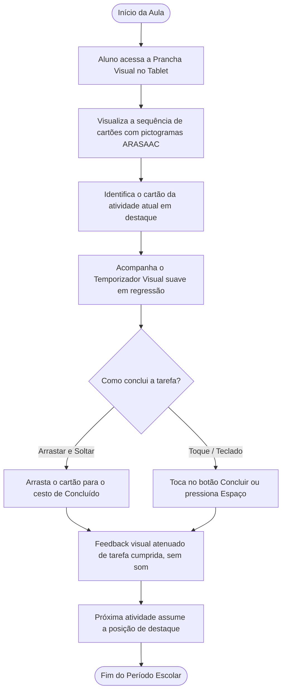
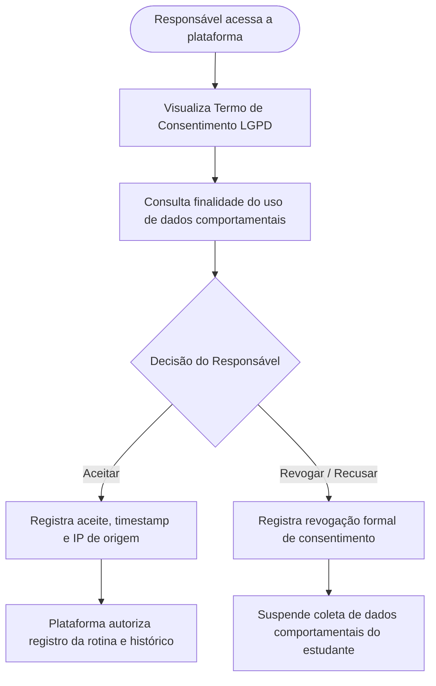

# Mapeamento de Processos e Fluxos do Sistema — RotinaTEA

Modelagem dos processos essenciais do sistema com notação de fluxo operacional e diagramas Mermaid.

---

## 1. Fluxo Principal: Execução da Rotina pelo Aluno com TEA

Representa o percurso diário da criança interagindo com a tecnologia assistiva para ter previsibilidade e concluir suas atividades.



---

## 2. Fluxo do Professor: Registro Rápido de Crise em 1 Clique (Offline-First)

Mapeamento do processo crítico em momento de estresse em sala de aula. Atualizado em 24/11/2026 para a arquitetura implementada (Supabase em vez da API Node.js prevista no desenho inicial e no Diagrama de Sequência de setembro; ver ADR em `ARQUITETURA_ENGENHARIA.md`).

```mermaid
sequenceDiagram
    autonumber
    actor Professor as Professor / Docente
    participant PWA as Interface PWA
    participant IDB as Banco Local (IndexedDB)
    participant Sync as Fila de Sincronização
    participant SB as Supabase (Auth + API + RLS)
    participant BD as Banco Central (PostgreSQL)

    Note over Professor,PWA: Momento de desregulação sensorial da criança
    Professor->>PWA: Clica no botão "Iniciar Crise" (1 clique)
    PWA->>IDB: Grava timestamp dataHoraInicio + estudanteId
    IDB-->>PWA: Confirmação de gravação local (RN03)
    PWA-->>Professor: Botão alterna para "Encerrar Crise" + cronômetro ativo

    Note over Professor,PWA: Crise é acolhida e estabilizada
    Professor->>PWA: Clica no botão "Encerrar Crise" (1 clique)
    PWA->>IDB: Grava dataHoraFim e calcula duracaoSegundos
    PWA->>Sync: Enfileira o registro (status pendente)

    alt Com conexão e sessão ativa
        Sync->>SB: upsert do registro pelo UUID local (idempotente)
        SB->>BD: INSERT/UPDATE sob RLS (só professor ou coordenação vinculados)
        BD-->>SB: Confirmação
        SB-->>Sync: Resposta de sucesso
        Sync-->>PWA: Item sai da fila; selo "Enviada ao servidor"
    else Sem conexão ou falha de envio
        Sync-->>PWA: Item permanece na fila; selo "Salva só neste aparelho"
        Note over Sync,SB: Nova tentativa quando a conexão voltar (até 3 tentativas; depois "Falhou o envio" e botão "Tentar novamente")
    end
```

---

## 3. Fluxo de Governança e Consentimento LGPD (Responsável Legal)



---

## 4. Fluxo de Tratamento de Exceções e Resolução de Erros
- **Desconexão Inesperada**: O sistema detecta o evento `window.addEventListener('offline')` e exibe um badge discreto: *"Modo Offline Ativo — Todos os dados continuam sendo salvos normalmente"*.
- **Tentativa de Sair com Crise Aberta (RN01)**: Se o usuário tentar fechar a janela com uma crise iniciada, o navegador intercepta a ação com `beforeunload` e modal de confirmação para impedir perda do encerramento da crise.
- **Falha de Carregamento de Recursos**: Caso algum pictograma remoto falhe na rede, o sistema realiza fallback automático para os pictogramas SVG embutidos localmente.
