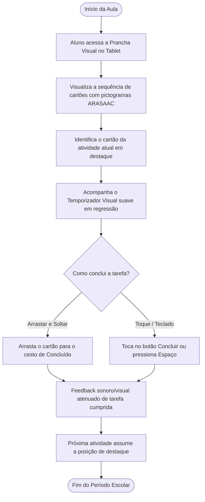
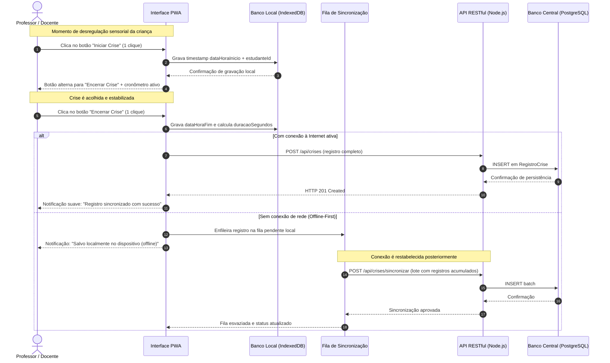
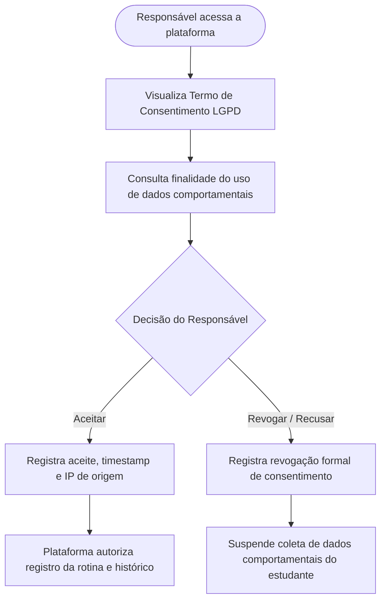

# Mapeamento de Processos e Fluxos do Sistema — RotinaTEA

Modelagem dos processos essenciais do sistema com notação de fluxo operacional e diagramas Mermaid.

---

## 1. Fluxo Principal: Execução da Rotina pelo Aluno com TEA

Representa o percurso diário da criança interagindo com a tecnologia assistiva para ter previsibilidade e concluir suas atividades.

---

## 2. Fluxo do Professor: Registro Rápido de Crise em 1 Clique (Offline-First)

Mapeamento do processo crítico em momento de estresse em sala de aula (alinhado ao Diagrama de Sequência oficial).

---

## 3. Fluxo de Governança e Consentimento LGPD (Responsável Legal)

---

## 4. Fluxo de Tratamento de Exceções e Resolução de Erros
- **Desconexão Inesperada**: O sistema detecta o evento `window.addEventListener('offline')` e exibe um badge discreto: *"Modo Offline Ativo — Todos os dados continuam sendo salvos normalmente"*.
- **Tentativa de Sair com Crise Aberta (RN01)**: Se o usuário tentar fechar a janela com uma crise iniciada, o navegador intercepta a ação com `beforeunload` e modal de confirmação para impedir perda do encerramento da crise.
- **Falha de Carregamento de Recursos**: Caso algum pictograma remoto falhe na rede, o sistema realiza fallback automático para os pictogramas SVG embutidos localmente.
