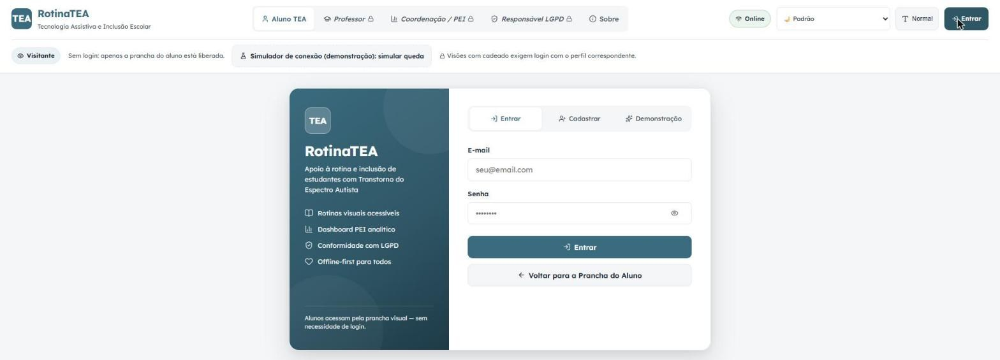
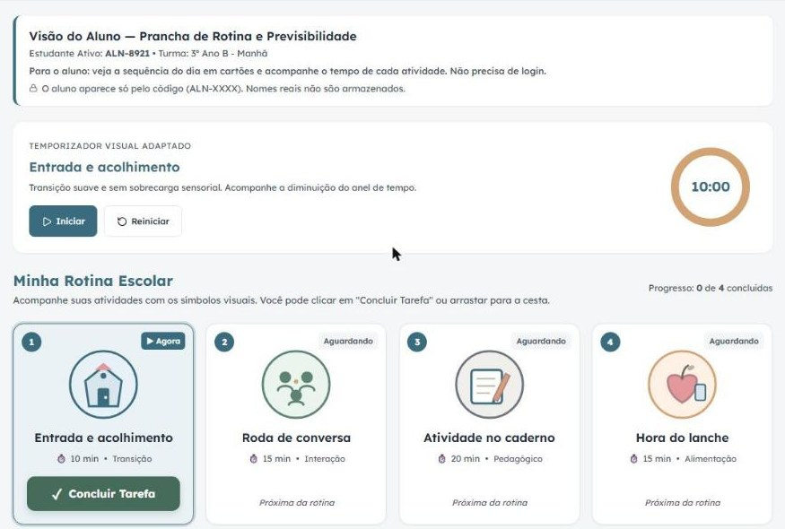
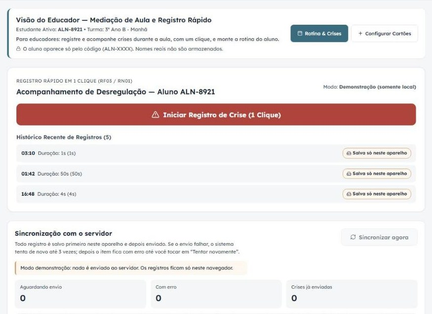
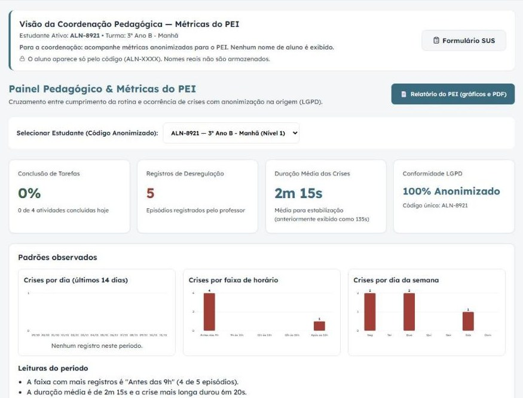

# RotinaTEA — Plataforma Digital de Tecnologia Assistiva

[](https://github.com/caiovgn-sudo/RotinaTEA/actions/workflows/ci.yml) [](app/src) [](https://react.dev) [](https://www.typescriptlang.org) [](ARQUITETURA_ENGENHARIA.md) [](DIRETRIZES_UX_ACESSIBILIDADE.md) [](ARQUITETURA_ENGENHARIA.md) 

> **Solução digital centrada nas necessidades reais de alunos com Transtorno do Espectro Autista (TEA), educadores, familiares e gestores escolares.**

O **RotinaTEA** é um Progressive Web App (PWA) acessível, intuitivo e com arquitetura *offline-first*, desenvolvido para promover previsibilidade, reduzir a sobrecarga sensorial e mitigar crises de ansiedade durante transições de atividades escolares, otimizando simultaneamente o registro e a análise comportamental pelos docentes para alimentar o Plano de Ensino Individualizado (PEI).

**Trabalho de Conclusão de Curso** · Sistemas de Informação · CEUNI FAMETRO · turma SIS231N01 · Manaus – AM · 2026
**Autores:** Caio Victor Galvão do Nascimento e Pedro Neves Alberto · **Orientadora:** Profa. Luana Magalhães Leal

### Funcionalidades

- **Prancha visual** com cartões de pictogramas ARASAAC, conclusão por clique, arraste ou teclado.
- **Temporizador visual** sem alarme sonoro, com anel que se esvazia.
- **Registro de crise em 1 clique**, com duração calculada e gravação local antes de qualquer envio (offline-first).
- **Painel do PEI** anonimizado, com gráficos por dia, faixa de horário e dia da semana, e relatório para impressão ou PDF.
- **Consentimento LGPD** revogável pelo responsável e formulário **SUS** integrado.
- **Três modos de contraste** e fonte ampliável.

### Tecnologias

React 18 · TypeScript · Vite · vite-plugin-pwa (Service Worker) · IndexedDB · Supabase (PostgreSQL, Auth, RLS) · Vitest.

### Situação atual (novembro de 2026)

| Item | Situação |
|---|---|
| Prancha visual, temporizador, registro de crise em 1 clique, painel do PEI, formulário SUS | Implementados |
| Testes automatizados | 121 testes em 10 arquivos, sem falhas (`npm test`); integração contínua no GitHub Actions |
| Sincronização com o Supabase | Testada com um dublê; teste ponta a ponta com conta real **pendente** |
| Publicação (Vercel) | **Publicado em 24/11/2026**: https://rotinatea.vercel.app (modo de demonstração desligado, só contas reais). Deploy automático pela `main`. Teste de ponta a ponta com conta real e ajuste do Site URL no Supabase **pendentes** |
| Validação com usuários (questionário de 7 perguntas) | 22 respostas, amostra de conveniência; aceitação preliminar favorável ([VALIDACAO_PRODUTO.md](VALIDACAO_PRODUTO.md)) |
| Avaliação de usabilidade (SUS) com educadores | **Não aplicada** |
| Dados | Fictícios; nenhuma criança real; alunos identificados só por código |

### Telas (modo de demonstração, dados fictícios)

| Entrada e perfis | Prancha do aluno |
|---|---|
|  |  |

| Registro de crise em 1 clique | Painel do PEI |
|---|---|
|  |  |

Também em `imagens/`: temporizador visual (`tela-3-temporizador.jpg`) e formulário SUS (`tela-6-formulario-sus.jpg`).

---

## 🎯 Diferencial Inovador

Enquanto ferramentas existentes focam exclusivamente em comunicação alternativa (SymboTalk), gamificação sem métricas (Rotina Divertida) ou possuem alta complexidade voltada a adultos (Tiimo), o **RotinaTEA integra duas frentes simultâneas**:
1. **Para o Aluno com TEA**: Prancha visual interativa com pictogramas padronizados (ARASAAC), drag-and-drop acessível e temporizador regressivo suave (sem gatilhos sensoriais).
2. **Para o Professor**: Botão de registro rápido de crises em **1 clique**, persistência imediata local (IndexedDB) e sincronização automática em lote, cruzando tarefas realizadas e gatilhos de desregulação.

---

## 🏛️ Alinhamento aos 5 Eixos Acadêmicos (CEUNI FAMETRO / ENADE)

1. **Eixo 1 — Tecnologia e Desenvolvimento de Software**: Engenharia de requisitos com foco em acessibilidade cognitiva, modelagem UML (casos de uso, classes, sequência), arquitetura cliente-servidor e frontend reativo PWA.
2. **Eixo 2 — Interação Humano-Computador (IHC) e UX/UI**: Design centrado no usuário neurodivergente, conformidade WCAG 2.1 AA, paleta de cores atenuadas, navegação por teclado e avaliação de usabilidade (questionário de validação com 22 respostas; SUS ainda não aplicado).
3. **Eixo 3 — Dados, Inteligência e Infraestrutura**: Persistência relacional e local (IndexedDB offline-first), painéis analíticos com correlação temporal e autenticação e controle de acesso por perfil (Supabase Auth e RLS).
4. **Eixo 4 — Gestão, Negócios e Governança de TI**: Otimização processual em sala de aula (registro sem sobrecarga), governança baseada em ITIL enxuto e exportação estruturada para o PEI.
5. **Eixo 5 — Transversal: Ética, Sustentabilidade e Sociedade (ODS)**: Alinhamento ao ODS 4 (Educação de Qualidade), principal, e ao ODS 3 (Saúde e Bem-Estar), complementar; conformidade rigorosa com a LGPD (anonimização na origem de dados de menores).

---

## 📂 Estrutura de Documentação do Projeto

- [README.md](README.md): Visão geral, guia de instalação e execução.
- [desenvolvimento/](desenvolvimento/): [Requisitos e regras de negócio](desenvolvimento/REQUISITOS_E_REGRAS_DE_NEGOCIO.md), [Padrões de projeto](desenvolvimento/PADROES_DE_PROJETO.md), [Avaliação heurística](desenvolvimento/AVALIACAO_HEURISTICA.md) e [Documento de interface (wireframes)](desenvolvimento/DOCUMENTO_DE_INTERFACE.md).
- [VALIDACAO_PRODUTO.md](VALIDACAO_PRODUTO.md): Resultados do questionário de validação com 22 participantes, sugestões e limites.
- [PROTOCOLO_AVALIACAO_SUS.md](PROTOCOLO_AVALIACAO_SUS.md): Protocolo de aplicação do SUS com educadores (ainda não aplicado), com rascunho de termo, tarefas e ficha de observação.
- [CRONOGRAMA.md](CRONOGRAMA.md): Cronograma de entregas e situação atual (a data da banca fica em branco).
- [ROTEIRO_BANCA_FINAL.md](ROTEIRO_BANCA_FINAL.md) e [GUIA_DO_DONO.md](GUIA_DO_DONO.md): Roteiro de 7 minutos com perguntas e respostas honestas, e guia de estado real do projeto.
- [CHECKLIST.md](CHECKLIST.md): Auditoria técnica de 26/10/2026 (histórica; a situação atual está no início do arquivo).
- [PLANEJAMENTO.md](PLANEJAMENTO.md): Tema, problema de pesquisa, personas, jornada do usuário, escopo e backlog priorizado (Kanban).
- [ARQUITETURA_ENGENHARIA.md](ARQUITETURA_ENGENHARIA.md): Arquitetura de software, offline-first, modelo de dados e decisões técnicas (ADR).
- [DIRETRIZES_UX_ACESSIBILIDADE.md](DIRETRIZES_UX_ACESSIBILIDADE.md): Acessibilidade cognitiva para TEA, paleta de cores, pictogramas ARASAAC e checklist WCAG.
- [PROCESSOS_FLUXOS.md](PROCESSOS_FLUXOS.md): Mapeamento de processos e fluxos BPMN (Mermaid).
- [PLANO_TESTES_QUALIDADE.md](PLANO_TESTES_QUALIDADE.md): Matriz de rastreabilidade, casos de teste (ISO/IEC 25010) e ciclo PDCA.
- [GOVERNANCA_SERVICOS_METAS.md](GOVERNANCA_SERVICOS_METAS.md): Gestão de incidentes (ITIL enxuto), matriz de riscos, indicadores e metas (KPIs).

---

## 🚀 Como Executar a Aplicação Localmente

### Pré-requisitos
- **Node.js** (versão 18 ou superior — testado no v24.21.0)
- **NPM** (versão 9 ou superior — testado no 11.19.0)

### Passos de Instalação e Execução
```bash
# 1. Navegue até a pasta da aplicação
cd app

# 2. Instale as dependências
npm install

# 3. Inicie o servidor de desenvolvimento
npm run dev

# 4. Execute os testes automatizados
npm test
```

A aplicação estará disponível em `http://localhost:5173`. Para ver o sistema sem criar conta, abra **Entrar → Demonstração** e escolha um perfil (dados fictícios, nada é enviado a servidor).

> **Vídeo de demonstração:** ainda não publicado. O link será acrescentado aqui e em `LINKS_DO_PROJETO.md`.


---

## 🧭 Como navegar pelo sistema (para avaliadores, educadores e responsáveis)

Abra a aba **Sobre** para ver o objetivo, os quatro perfis, as regras RN01 a RN03 e o caminho de uma crise. Abaixo do cabeçalho, uma faixa informa o tipo de acesso: **Visitante**, **Conta real** ou **Modo demonstração** (dados fictícios, só neste navegador).

| Perfil | Como entrar | O que faz |
|---|---|---|
| Aluno | sem login | rotina visual em cartões e temporizador |
| Professor | login ou demonstração | registro de crise em 1 clique, configuração da rotina, painel de sincronização |
| Coordenação | login ou demonstração | painel anonimizado do PEI com gráficos e relatório, formulário SUS e resultados agregados do SUS |
| Responsável | login ou demonstração | termo da LGPD, consentimento e como revogar |

Em **demonstração** não existe senha e nada é enviado ao servidor. Contas reais são criadas na aba **Cadastrar** e entram sempre como Responsável; Professor e Coordenação são concedidos por um administrador (consulte o fim de `app/supabase/migrations/20261028000001_endurece_perfis.sql`).

### Variáveis de ambiente de interface (`app/.env.example`)

| Variável | Efeito |
|---|---|
| `VITE_MODO_DEMO` | `true` habilita o login de demonstração e o simulador de conexão. Use `false` em produção. |
| `VITE_SUS_ATALHOS_TESTE` | `true` mostra no SUS os atalhos "Todos Neutro/Concordo". Use só em desenvolvimento. |

### Publicação e teste com conta real

Passo a passo da publicação na Vercel, da troca da chave pública do Supabase, da ordem das migrações e do roteiro de teste de ponta a ponta (crise, SUS e consentimento com conta real): [DEPLOY_VERCEL.md](DEPLOY_VERCEL.md).

### Melhorias de UX (outubro de 2026)

Orientação por visão, navegação com visões bloqueadas explicadas, conexão real separada do simulador, painel de sincronização, selos de envio por crise, registro de atividades, diálogo de confirmação, painel da LGPD detalhado e ajustes de acessibilidade. Antes e depois, decisões e roteiro de teste: [MELHORIAS_UX_2026-10.md](MELHORIAS_UX_2026-10.md).

**Limitações (não concluído):** a revogação do consentimento bloqueia novos registros de crise apenas no aparelho (sem regra no servidor); o IP do aceite não é capturado; a redação da base legal precisa de revisão; a medição de contraste cobre apenas texto (não mede bordas, ícones e anel do temporizador); não houve teste com leitor de tela nem com conta real do Supabase para a sessão encerrada e a sincronização.
